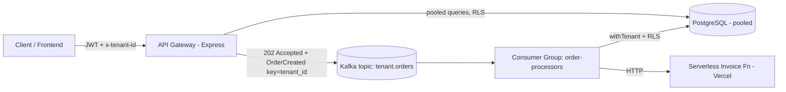

# Multi-Tenant B2B SaaS - Kafka, DB Tuning & Serverless

Node.js + Express + PostgreSQL (Neon, with Row Level Security) + KafkaJS (Aiven Kafka) + Serverless function (Vercel).

## Live Links
- **GitHub repo:** https://github.com/nimramumtaz/saas-kafka
- **Live app (Render):** _paste Render URL here_
- **Serverless function (Vercel):** _paste Vercel URL here_/api/invoice
- **Kafka:** Aiven Kafka (free tier), topic `tenant.orders`
- **Database:** Neon PostgreSQL

## Architecture


## Multi-tenancy
- **Model:** shared database, `tenant_id` discriminator on every table.
- **Resolution:** `tenant_id` is a signed JWT claim; the optional `x-tenant-id` header must match it, otherwise the API returns 403.
- **Isolation (2 layers):** (1) every query runs through `withTenant()` which sets `app.tenant_id`; (2) PostgreSQL **Row Level Security** (`FORCE`) with a non-superuser role (`app_user`), so even a forgotten `WHERE` cannot leak data.
- Prove it: `npm run isolation`.

## Test accounts (password: `password123`)
| Tenant | Slug | Email |
|---|---|---|
| A | acme | admin@acme.com |
| B | globex | admin@globex.com |

## Run locally
Without Docker (cloud Neon + Aiven): see [SETUP-NO-DOCKER.md](SETUP-NO-DOCKER.md).
```bash
npm install
npm run seed:bulk      # tenants, users, products + bulk orders
npm start              # API + consumer on http://localhost:3000 (set RUN_CONSUMER=true in .env)
```
With Docker instead: `docker compose up -d` first, then the same commands.

## Kafka
- `POST /api/v1/orders` -> `202 Accepted` + `{partition, offset}`; event `OrderCreated` on topic `tenant.orders`.
- Message key = `tenant_id` -> per-tenant ordering (same partition).
- Consumer (KafkaJS, group `order-processors`) inserts the order, decrements inventory (idempotent via primary key), logs `partition/offset`, and calls the serverless invoice function.

## Benchmarks
Run `npm run benchmark` (writes `BENCHMARK_RESULTS.md`).

| Test | Before | After |
|---|---|---|
| N+1 (51 queries) vs JOIN (1 query) | _fill_ ms | _fill_ ms |
| EXPLAIN ANALYZE `WHERE tenant_id ORDER BY created_at DESC LIMIT 50` (Seq Scan -> Index Scan on `(tenant_id, created_at DESC)`) | _fill_ ms | _fill_ ms |

Connection pooling: `pg.Pool` with `max=20`, `idleTimeoutMillis=30000`, `connectionTimeoutMillis=5000` (`src/db.js`).

## Screenshots

> Edit the captions below to match what each screenshot shows (e.g. EXPLAIN ANALYZE before/after, Kafka consumer offsets, cold vs warm start).

**Screenshot 1**


**Screenshot 2**


**Screenshot 3**


## Serverless cold vs warm start
`api/invoice.js` keeps a module-level counter. The first invocation per container is a **cold start** (`coldStart:true`); later calls are **warm** (`coldStart:false`). The consumer logs `[invoice-fn] COLD/WARM | handler | roundtrip`.

| Invocation | Type | Round-trip ms |
|---|---|---|
| 1st after idle | Cold | _fill_ |
| 2nd, 3rd | Warm | _fill_ |

## Deployment
1. **Postgres (Neon):** run `db/schema.sql` in the SQL editor, set `DATABASE_URL` (app_user), `ADMIN_DATABASE_URL`, `PG_SSL=true`, then `npm run seed:bulk`.
2. **Kafka (Aiven free tier):** create topic `tenant.orders`; set `KAFKA_BROKERS`, `KAFKA_SSL=true`, `KAFKA_USERNAME`, `KAFKA_PASSWORD`, `KAFKA_SASL_MECHANISM`, and the CA certificate (`KAFKA_CA_PATH` locally or `KAFKA_CA_B64` on the host).
3. **API + frontend + consumer (Render):** start command `npm start`, env `RUN_CONSUMER=true`.
4. **Serverless (Vercel):** import the repo; `/api/invoice` goes live. Set `INVOICE_FUNCTION_URL` on the API service.

## Viva cheat sheet
- Trigger an event: place an order in the UI -> show the `202` response with partition/offset.
- Offsets: the consumer log prints `partition= offset=`; Aiven console > Topics > `tenant.orders` > Messages.
- EXPLAIN live (Neon SQL Editor):
  `DROP INDEX IF EXISTS idx_orders_tenant_created;` then
  `EXPLAIN ANALYZE SELECT * FROM orders WHERE tenant_id=(SELECT id FROM tenants WHERE slug='acme') ORDER BY created_at DESC LIMIT 50;`
  then `CREATE INDEX idx_orders_tenant_created ON orders (tenant_id, created_at DESC);` and run the EXPLAIN again.
