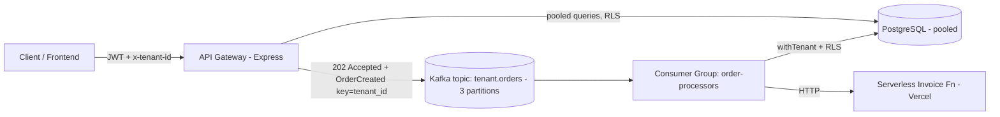

# Multi-Tenant B2B SaaS - Kafka, DB Tuning & Serverless

Node.js + Express + PostgreSQL (RLS) + KafkaJS (Redpanda/Upstash) + Serverless function (Vercel).

## Architecture


## Multi-tenancy
- **Model:** shared DB, `tenant_id` discriminator on every table.
- **Resolution:** `tenant_id` is a signed JWT claim; optional `x-tenant-id` header must match or the API returns 403.
- **Isolation (2 layers):** (1) every query runs through `withTenant()` which sets `app.tenant_id`; (2) PostgreSQL **Row Level Security** (`FORCE`) with a non-superuser role, so even a forgotten `WHERE` cannot leak data.
- Prove it: `npm run isolation`.

## Test accounts (password: `password123`)
| Tenant | Slug | Email |
|---|---|---|
| A | acme | admin@acme.com |
| B | globex | admin@globex.com |

## Run locally (with Docker) - Docker nahi hai? SETUP-NO-DOCKER.md dekho

```bash
npm install
docker compose up -d          # Postgres + Redpanda (Kafka)
npm run seed:bulk             # tenants, users, products + 100k orders per tenant
npm run dev                   # API + consumer on http://localhost:3000
```
Open http://localhost:3000, log in, place an order. Optional: run the consumer separately with `npm run consumer` (set `RUN_CONSUMER=false`).

## Kafka
- `POST /api/v1/orders` -> `202 Accepted` + `{partition, offset}`; event `OrderCreated` on `tenant.orders`.
- Message key = `tenant_id` -> per-tenant ordering (same partition).
- Consumer (KafkaJS, group `order-processors`) inserts order, decrements inventory (idempotent via PK), logs `partition/offset`, calls the serverless invoice function.
- Cloud: create Upstash/Aiven topic `tenant.orders`, set `KAFKA_BROKERS`, `KAFKA_SSL=true`, `KAFKA_USERNAME`, `KAFKA_PASSWORD`, `KAFKA_SASL_MECHANISM` in env.

## Benchmarks
Run `npm run benchmark` (writes `BENCHMARK_RESULTS.md`). **Paste your results + screenshots here:**

| Test | Before | After |
|---|---|---|
| N+1 (51 queries) vs JOIN (1 query) | _fill_ ms | _fill_ ms |
| EXPLAIN ANALYZE `WHERE tenant_id ORDER BY created_at DESC LIMIT 50` (Seq Scan -> Index Scan on `(tenant_id, created_at DESC)`) | _fill_ ms | _fill_ ms |

Connection pooling: `pg.Pool` with `max=20`, `idleTimeoutMillis=30000`, `connectionTimeoutMillis=5000` (`src/db.js`).

## Serverless cold vs warm start
`api/invoice.js` keeps a module-level counter. First invocation per container = **cold** (`coldStart:true`), later = **warm**. Consumer logs `[invoice-fn] COLD/WARM | handler | roundtrip`.
Record in this table (curl the Vercel URL, wait ~15 min idle, curl again):

| Invocation | Type | Round-trip ms |
|---|---|---|
| 1st after idle | Cold | _fill_ |
| 2nd, 3rd | Warm | _fill_ |

## Deployment
1. **Postgres:** Neon/Supabase/Render. Run `db/schema.sql` on it (admin user), then set `DATABASE_URL` (app_user), `ADMIN_DATABASE_URL`, `PG_SSL=true`, then `npm run seed:bulk`.
2. **API + frontend + consumer:** Render/Railway Web Service, start `npm start`, env `RUN_CONSUMER=true` + all vars from `.env.example`.
3. **Serverless:** push repo to GitHub -> import in Vercel -> `/api/invoice` is live. Set `INVOICE_FUNCTION_URL=https://<project>.vercel.app/api/invoice` on the API service.

## Viva cheat sheet
- Trigger event: place order in UI or curl POST /orders -> show 202 with partition/offset.
- Offsets: consumer terminal prints `partition= offset=`; or `docker compose exec redpanda rpk group describe order-processors`.
- EXPLAIN live: `docker compose exec postgres psql -U postgres saas`, then
  `EXPLAIN ANALYZE SELECT * FROM orders WHERE tenant_id=(SELECT id FROM tenants WHERE slug='acme') ORDER BY created_at DESC LIMIT 50;` (run `DROP INDEX idx_orders_tenant_created;` first for the "before").
